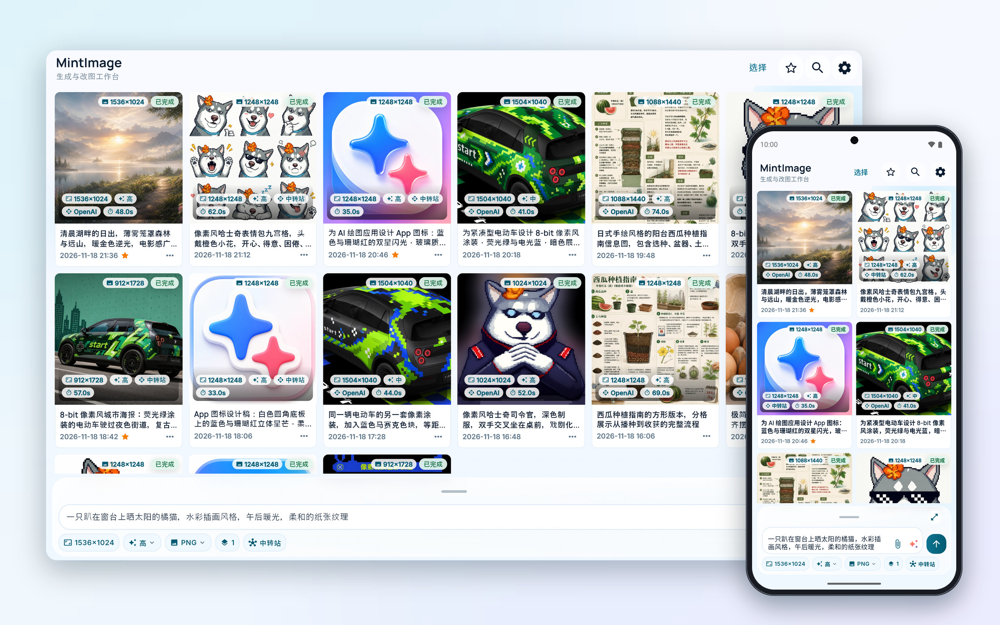
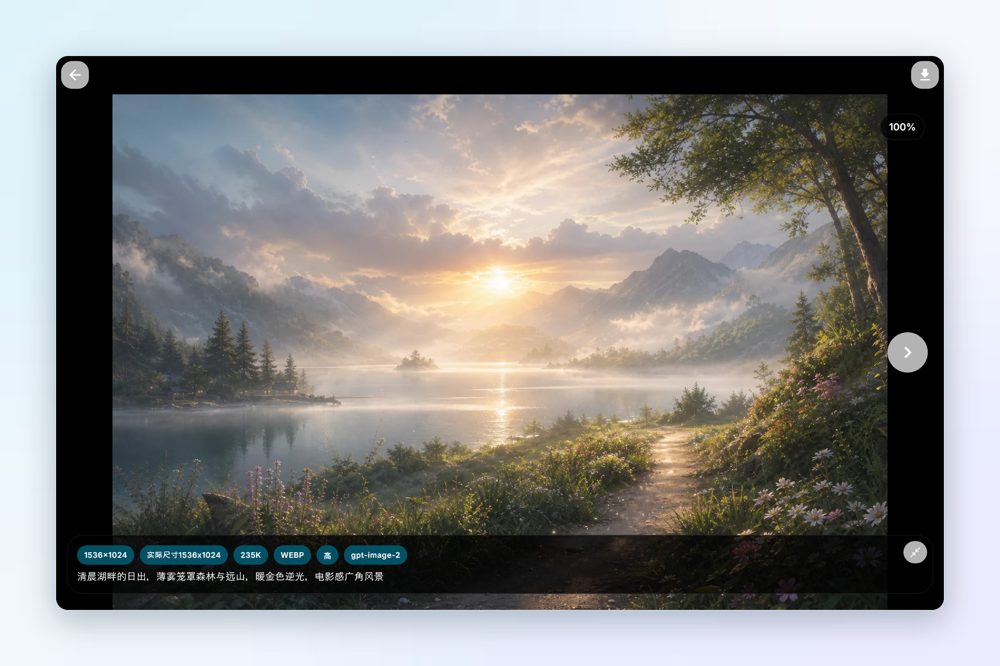
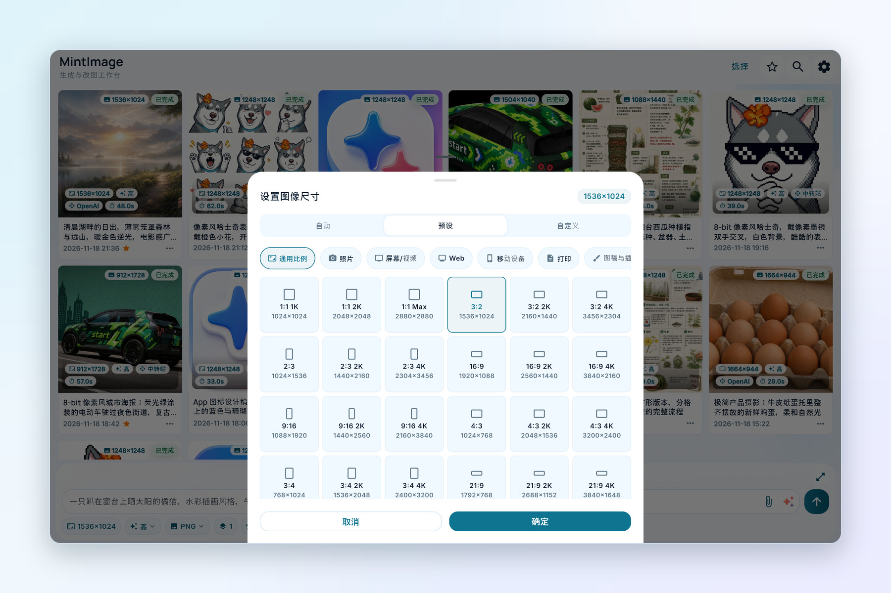
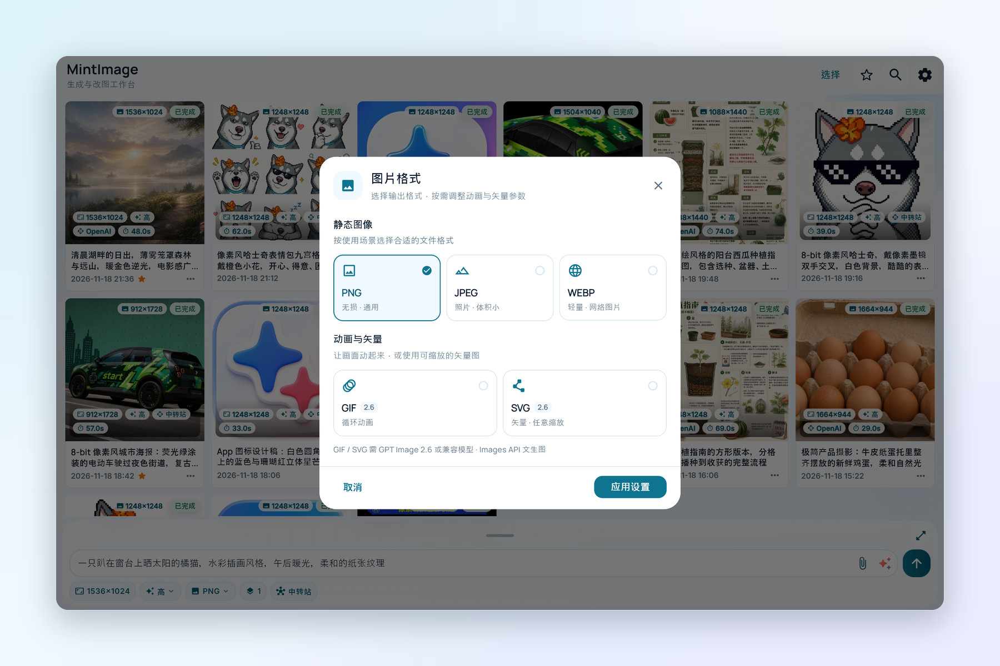

<div align="center">


# MintImage

**跨平台 AI 图像生成客户端**

一句提示词生成图片，一张参考图改出新风格。<br/>
兼容所有 OpenAI 格式的图像 API，Windows / macOS / Android 通用，还附带可供 Agent 调用的命令行。

[](https://github.com/aiqinxuancai/MintImage/releases/latest)


[](https://github.com/aiqinxuancai/MintImage/releases/latest/download/MintImage-windows-x64.zip)
[](https://github.com/aiqinxuancai/MintImage/releases/latest/download/MintImage-macos-arm64.zip)
[](https://github.com/aiqinxuancai/MintImage/releases/latest/download/app-release.apk)



</div>

## ✨ 功能

<table>
<tr>
<td width="50%" valign="top">

### 🎨 创作

- **文生图** — 输入提示词，AI 为你生成图片
- **图生图** — 上传一张或多张参考图，用文字描述修改方向
- **标注引导** — 在参考图上圈选、涂画修改意图（需要支持 markup 的模型与服务商）
- **提示词优化** — 一键润色提示词，让描述更精准
- **长提示词编辑** — 拖动输入框上方横条调整高度，或全屏编辑，返回时保留草稿与光标

</td>
<td width="50%" valign="top">

### 🖼️ 输出

- **丰富尺寸** — 1K / 2K / 4K 多档位、8 种常用比例，或自定义任意宽高
- **批量生成** — 一次最多生成 16 张
- **多种格式** — PNG / JPEG / WebP 静态图
- **GIF / SVG** — 支持 GPT Image 2.6 的动画和矢量输出，可调帧数与帧时长，支持动画播放、SVG 缩放预览和原格式保存（[能力与限制](docs/GPT_IMAGE_2_6.md)）
- **大图附件** — 支持选择、粘贴超过 25 MB 的参考图，实际上传上限由所用 API 决定

</td>
</tr>
<tr>
<td width="50%" valign="top">

### 🗂️ 管理

- **历史记录** — 所有生成结果本地保存，离线可查，支持按提示词搜索
- **收藏夹** — 把满意的结果分类整理，随时回看
- **多配置切换** — 同时管理多个 API 地址与密钥，一键切换
- **备份与同步** — 通过 WebDAV 或 `.mintbackup` 文件备份、恢复设置、历史记录和图片

</td>
<td width="50%" valign="top">

### 🤖 自动化

- **命令行生图** — Windows / macOS 独立控制台程序，执行完即退出
- **为 Agent 设计** — 支持批量并行、JSON 结果和错误退出码
- **复用应用配置** — 自动读取在应用中选中的 API 配置，无需重复填写密钥

</td>
</tr>
</table>

## 📸 截图

### 🖥️ 桌面端

<table>
<tr>
<td width="50%"></td>
<td width="50%"></td>
</tr>
<tr>
<td align="center"><sub><b>大图预览</b> · 缩放查看，附带尺寸、格式、模型与提示词</sub></td>
<td align="center"><sub><b>尺寸预设</b> · 1K / 2K / 4K 与常用比例，也可自定义宽高</sub></td>
</tr>
<tr>
<td width="50%"></td>
<td width="50%"></td>
</tr>
<tr>
<td align="center"><sub><b>输出格式</b> · PNG / JPEG / WebP，以及 2.6 的 GIF 与 SVG</sub></td>
<td align="center"><sub><b>设置</b> · 多套生图与提示词优化配置、备份与同步</sub></td>
</tr>
</table>

### 📱 移动端


## 🚀 快速开始

1. 从 [Releases](https://github.com/aiqinxuancai/MintImage/releases) 下载对应平台的安装包
2. 打开应用，进入设置页
3. 填写 API 地址、密钥和模型名
4. 回到主页，输入提示词，开始生成

<details>
<summary><b>使用 RightAPI 画图接口</b></summary>

<br/>

使用 [RightAPI 画图接口](https://docs.rightapi.ai/docs/rc_draw/) 时，Base URL 填写 `https://api.site`，生图 API 选择 `Images API（异步任务）`，可先用 `gpt-image-2` 验证。该模式发送 `async: true`，通过 `/v1/tasks/{task_id}` 查询结果，兼容使用相同协议的任意域名；普通 `Images API` 收到 `task_id` 时也会自动轮询。旧 RightAPI 配置会迁移到异步模式，换域名时只需修改 Base URL。GPT Image 模型使用 `1024x1024` 等像素尺寸，图生图通过 `/v1/images/edits` 提交。模型权限和可用性以你的 key 所属分组为准。

</details>

<details>
<summary><b>使用 TryAIGC</b></summary>

<br/>

使用 [TryAIGC](https://api.tryaigc.cn) 时，Base URL 填写 `https://api.tryaigc.cn`，生图 API 选择 `Images API`。已实测 `gpt-image-2` 在关闭流式请求时可以生成图片，建议保留默认的 600 秒超时；可用模型以你的 key 获取到的模型列表为准。

</details>

## ⌨️ 命令行与 Agent 调用

命令行功能随完整桌面包一起提供，不单独发布 CLI 包。解压 `MintImage-windows-x64.zip` 或 `MintImage-macos-arm64.zip` 后，图形界面正常启动；Agent 可调用包内的 `cli/bin/mint-image.exe`（Windows）或 `cli/bin/mint-image`（macOS）进行生图，无需安装 Flutter，也不会创建 UI。完整参数、图生图和错误协议见 [命令行文档](docs/CLI.md)。

<details open>
<summary><b>Windows PowerShell 示例</b></summary>

```powershell
.\cli\bin\mint-image.exe profiles
.\cli\bin\mint-image.exe generate --prompt "薄荷绿背景上的一只猫" --count 4 --parallel 2 --output-dir .\images
.\cli\bin\mint-image.exe generate --profile "我的生图配置" --prompt "水彩风格的山间小屋" --output .\cabin.png
$LASTEXITCODE
```

</details>

<details>
<summary><b>macOS 示例</b></summary>

```bash
./cli/bin/mint-image profiles
./cli/bin/mint-image generate --prompt '薄荷绿背景上的一只猫' --count 4 --parallel 2 --output-dir ./images
./cli/bin/mint-image generate --profile '我的生图配置' --prompt '水彩风格的山间小屋' --output ./cabin.png
echo $?
```

</details>

- **配置**：CLI 默认读取当前用户在 MintImage 中保存并选中的生图配置，无需重复填写密钥、地址或模型；也会继承 API 协议、流式开关和请求超时。`--profile` 可按名称或 ID 选择，`profiles` 以 JSON 列出配置但不输出密钥。命令行参数、`MINT_IMAGE_*` 环境变量可以覆盖已保存配置，`--no-app-config` 可关闭自动读取。
- **输出**：`stdout` 返回一份 JSON，包含每个任务的状态和图片绝对路径；错误同时写入 `stderr`，保留 HTTP 状态码和接口原因。
- **退出码**：`0` 表示全部成功，`1` 表示运行失败或部分失败，`2` 表示参数、配置或输入错误。支持多个进程同时调用，自动生成的文件名不会互相覆盖。

## 📦 自行构建

```bash
flutter pub get
flutter run            # 调试运行
flutter build windows  # 或 macos / apk
dart run tool/build_cli.dart  # 在目标系统上构建 CLI：build/cli/bundle/
```

---

<div align="center">

该项目已在 [LINUX DO](https://linux.do/) 社区分享。

基于 [MIT](LICENSE) 协议开源。

</div>
